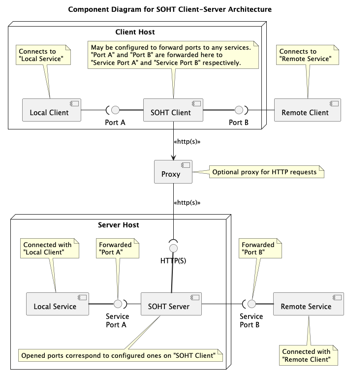
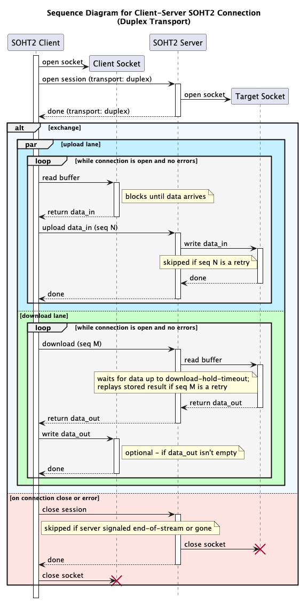
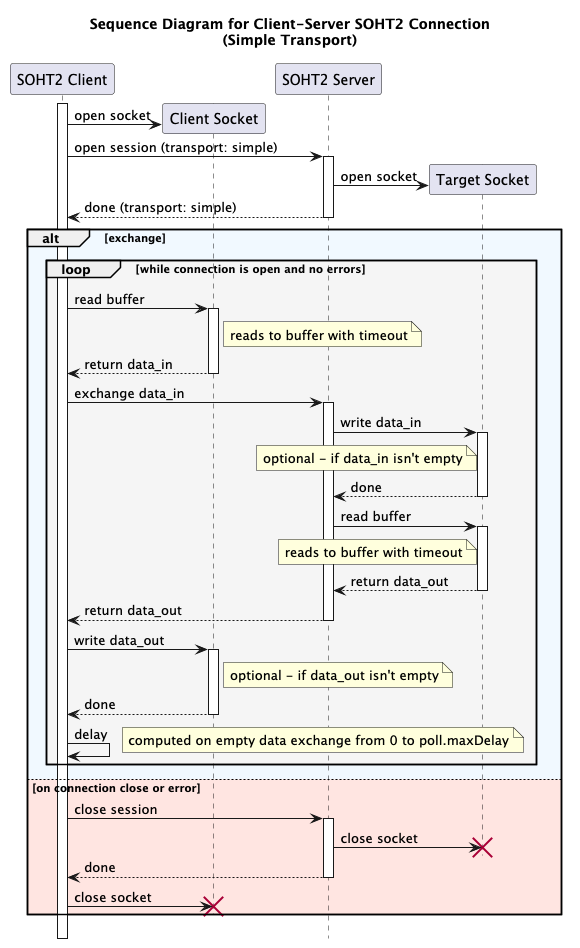

SOHT2 - Socket Over HTTP Tunnel 2
=================================

[](https://openjdk.org "OpenJDK homepage")
[](https://spring.io/projects/spring-boot "Spring Boot homepage")
[](https://typescriptlang.org "TypeScript homepage")
[](https://reactjs.org "React homepage")
[](https://nodejs.org/en "Node.js homepage")<br>
[](https://opensource.org/licenses/MIT "MIT License page")
[](https://github.com/domax/soht2/actions/workflows/github-code-scanning/codeql)
[](https://github.com/domax/soht2/actions/workflows/gradle-publish.yml)

[](https://www.buymeacoffee.com/domax)

---

SOHT2 is a Java-based API that provides a secure and efficient way to tunnel socket connections over
HTTP. It is designed to work seamlessly with various applications that require socket communication,
such as web services, IoT devices, and more.

This project was inspired by the [original SOHT project](https://www.ericdaugherty.com/dev/soht/)
but has been rewritten using modern Java to improve performance, reliability, and maintainability.

SOHT2 leverages modern Java features and best practices to deliver a robust and flexible solution
for socket tunneling needs. It is built with a focus on simplicity and ease of use, making it
accessible for users of all skill levels.

It supports both client and server modes, allowing you to create a tunnel for outgoing connections
or to accept incoming connections through an optional HTTP proxy.

Disclaimer
----------

This project is not affiliated with or endorsed by the original SOHT project or its authors. It is
an independent implementation that aims to provide similar functionality with modern Java practices.

Also, this project is not a legal advice or a security solution. It is provided "as is" without any
warranties or guarantees. Use it at your own risk.

Please review the code and documentation carefully before using it in production environments.
For any legal or security concerns, consult with a qualified professional.

This project is intended for educational and informational purposes only.

By using this project, you agree to the terms of the [MIT License](LICENSE.txt) and then merge it
into the site-policy repo. This is to ensure that I can review and iterate on the changes before
they are made public. I appreciate your understanding and cooperation in this process.

How It Works
------------

SOHT2 establishes a tunnel between a client and a server over HTTP. The client sends socket
connection requests to the server, which then forwards these requests to the appropriate remote
hosts. The server acts as a bridge, allowing the client to communicate with remote hosts without
exposing them directly to the client.



SOHT2 supports two transport modes: `duplex` and `simple`.

The `duplex` (default) mode uses two independent HTTP lanes for upload and download, allowing for
simultaneous bidirectional communication:



The `simple` mode uses a single HTTP request for each round trip, with the client polling for data:



The `duplex` mode is preferred for interactive traffic, while the `simple` mode is suitable for
scenarios where long-lived connections are not feasible.

How to Configure And Run
------------------------

Both the client and server components can be run using Java, so on both sides you need to have Java
21 or later installed.

### Server Side

1. Get the latest release, e.g. `soht2-server-X.X.X.jar`
   from [packages](https://github.com/domax/soht2/packages).
2. Create/Edit the `application-server.yaml` file to configure the server settings, and
   place it in the same directory as the JAR file. Here is an example configuration:
    ```yaml
    soht2.server:
      socket-read-timeout: PT0.1S                  # Timeout for socket read operations
      read-buffer-size: 1MB                        # Size of the read buffer for socket connections
      user-cache-ttl: PT10M                        # TTL for user and verified-credential cache
      database-path: ./soht2                       # Path to the database file
      admin-username: "${SOHT2_USR}"               # Username for the admin user
      default-admin-password: "${SOHT2_PWD}"       # Default password for the admin user
      open-api-server-url: https://${SOHT2_SERVER} # Public URL of the OpenAPI server
      enable-history: true                         # Enable gathering connection history
      download-hold-timeout: PT25S                 # Max time a duplex download waits for data
      abandoned-connections:                       # Settings for abandoned connections
        timeout: PT1M                              # Timeout for abandoned connections
        check-interval: PT5S                       # Interval for checking abandoned connections
    ```
   All settings are optional, but you have to define `soht2.server.database-path`,
   `soht2.server.admin-username`, and `soht2.server.default-admin-password` to create database and
   admin user for the server.

   The server advertises the duplex transport (see [Transport](#transport)) and holds each download
   request for up to `soht2.server.download-hold-timeout`. Any reverse proxy in front of the server
   must allow requests to last longer than this hold time (e.g. Nginx `proxy_read_timeout`, 60s by
   default).
3. Run the server with the following command:
    ```shell
    java -jar soht2-server-X.X.X.jar
    ```
   __IMPORTANT! Change your admin's password via UI or REST API right after the server starts.__

### Client Side

1. Get the latest release, e.g. `soht2-client-X.X.X.jar`
   from [packages](https://github.com/domax/soht2/packages).
2. Create/Edit the `application-client.yaml` file to configure the client settings, and
   place it in the same directory as the JAR file. Here is an example configuration
   _(precise values in this example represent the default values for the client, so you can omit
   them if they work for you)_:
    ```yaml
    soht2.client:
      url: https://${SOHT2_SERVER}/api/connection # URL of the SOHT2 server API endpoint
      transport: duplex               # Tunnel transport (duplex, simple), see "Transport" below
      socket-read-timeout: PT0.1S     # Timeout for reading from socket connections
      read-buffer-size: 1MB           # Size of the read buffer for socket connections
      username: "${SOHT2_USR}"        # Username for authentication on SOHT2 server
      password: "${SOHT2_PWD}"        # Password for authentication on SOHT2 server
      connections:                    # List of connections to establish - at least 1 item required
      - local-port: ${LOCAL_PORT}     # Local port to listen on
        remote-host: ${REMOTE_HOST}   # Remote host to connect to
        remote-port: ${REMOTE_PORT}   # Port on a remote host to connect to
      compression:                    # Compression settings for the connections
        type: none                    # Compression type for the connections (none, gzip, deflate)
        min-request-size: 2KB         # Minimum request size to apply compression
      poll:                           # Polling settings - used by the simple transport only
        strategy: exponent            # Polling strategy for connections (exponent, linear, fixed)
        initial-delay: PT0.1S         # Initial delay before the first poll retry
        max-delay: PT1S               # Maximum delay between retries
        factor: 5                     # Factor for exponential backoff
      proxy:                          # HTTP proxy configuration
        host: ${PROXY_HOST}           # If defined, the client sets up an HTTP proxy to this host
        port: 3128                    # Port of the HTTP proxy host
        auth: basic                   # Proxy authentication type (basic, ntlm)
        username: "${PROXY_USR}"      # Optional, only for BASIC or NTLM proxy authentication
        password: "${PROXY_PWD}"      # Optional, only for BASIC or NTLM proxy authentication
        domain: ${PROXY_DOMAIN}       # Optional, only if NTLM proxy requires domain name
      disable-ssl-verification: false # Disable SSL verification for the connections
      disconnect-on-idle-timeout: P0D # Timeout for closing idle connections; P0D means never
      max-http-connections: 100       # Max concurrent HTTP connections to the server
    ```
   You have to define `soht2.client.url` and at least one connection in the
   `soht2.client.connections` list. All the rest of properties are optional.

   If you want to use an HTTP proxy, you can define the `soht2.client.proxy` section with
   appropriate values.

   The client automatically sends `X-SOHT2-Client: soht2-client` on tunnel requests so it can
   operate with the server's browser CSRF protection. Do not remove or override this header when
   customizing the client's HTTP transport.

   If you want to use SOCKS5 proxy, just add `-DsocksProxyHost=localhost -DsocksProxyPort=1080` to
   the list of JVM options (see next step) - but set the correct host and port, of course.

   _Be aware that this implementation does not support authentication for SOCKS5 proxy._

   With the duplex transport, the client's HTTP read timeout (60s by default, see
   `spring.http.clients.read-timeout`) and any HTTP proxy between the client and the server must
   allow requests to last longer than the server's `soht2.server.download-hold-timeout` (25s by
   default).
3. Run the client with the following command:
    ```shell
    java -jar soht2-client-X.X.X.jar
    ```
   Or, with SOCKS5 proxy:
    ```shell
    java -DsocksProxyHost=localhost -DsocksProxyPort=1080 -jar soht2-client-X.X.X.jar
    ```
4. If you don't have errors, you should be able to connect to the remote host through the tunnel.
   You can test it by running `telnet localhost ${LOCAL_PORT}` (or whatever local port you defined
   in the configuration) and then trying to connect to the remote host, e.g. in case of SSH:
   `ssh -p ${LOCAL_PORT} user@localhost`.

### Transport

The client supports two tunnel transports, selected with `soht2.client.transport`:

* `duplex` (default) - each session uses two independent HTTP lanes: an upload lane
  (`POST /api/connection/{id}/upload`) that sends local data as soon as it is read, and a download
  lane (`GET /api/connection/{id}/download`) that the server holds open until the remote host sends
  data, closes its connection, or the hold timeout elapses. Both directions flow at the same time
  without client-side polling, so interactive traffic (e.g. SSH) responds within one round trip.
  Each active session uses up to two concurrent HTTP requests, so keep
  `soht2.client.max-http-connections` at least twice the number of expected concurrent sessions.
* `simple` - the original transport: one request per round trip carries both directions, and the
  client polls with the `soht2.client.poll` settings while the session is idle.

The client uses duplex only if the server advertises it when a connection is opened; with an older
server it falls back to `simple` automatically (logged once at INFO level). To roll back to the
original behavior, for example when a proxy cannot hold long requests, set
`soht2.client.transport: simple`.

Tips & Tricks
-------------

* [SOHT2 Server](doc/tips-server.md)
* [SOHT2 Client](doc/tips-client.md)
